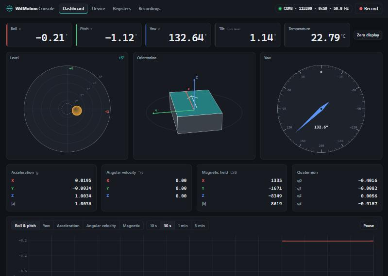

# WitMotion

A Python engine and browser console for **WitMotion** tilt / IMU sensors.

It was built and tested against a **WT901C-485** (9-axis digital inclinometer, RS-485 / Modbus RTU)
on a USB-485 adapter, and it also speaks the WitMotion "standard" 0x55 streaming protocol that the
TTL and RS-232 models use.



- **Engine:** pure Python plus `pyserial`. Modbus RTU driver, 0x55 stream parser, full register map,
  calibration and configuration commands, CSV recording, port scanning, and a built-in simulator.
- **Browser console:** live roll / pitch / yaw / tilt readouts, a bubble level, a 3D orientation view,
  a yaw dial, rolling charts, device settings, calibration, a raw register editor, and recordings.
  No build step and no CDN: it runs offline, in the field.
- **CLI:** `scan`, `read`, `log`, `dump`, `config`, `serve`.

## Quick start

```bash
pip install -r requirements.txt
python -m witmotion            # starts the console at http://localhost:8765 and opens a browser
```

The first time, the **Connect** dialog opens: pick the serial port (USB-serial bridges are marked ★)
or press **Scan for sensors**. The console remembers the last sensor and reconnects on the next start.

Other ways to start:

```bash
python -m witmotion serve --device COM8 --baud 115200 --address 0x50
python -m witmotion serve --simulate          # no hardware needed
python -m witmotion scan                      # find sensors on USB-serial ports
```

Or install it as a command: `pip install .` then run `witmotion`.

### Windows desktop launcher

`start-witmotion.bat` starts the console and opens the browser. It installs `pyserial` the first time if
it's missing, and if the console is already running it just opens the browser. Recordings and settings
go to `witmotion-data\` next to the batch file. To put a **WitMotion Console** icon on your desktop:

```bash
powershell -ExecutionPolicy Bypass -File create-shortcut.ps1
```

Closing the console window stops the engine and releases the serial port, so close it before using
WitMotion's own software on the same port.

## Supported hardware

| Model | Interface | Protocol | Status |
|---|---|---|---|
| WT901C-485 | RS-485 | Modbus RTU (`--protocol modbus`) | Tested on hardware |
| HWT901B-485, HWT905-485, HWT901T-485, WT605-485, HWT603-485 | RS-485 | Modbus RTU | Same register map in WitMotion's software; should work |
| WT901C-TTL, WT901C-232, JY901 family | TTL / RS-232 | Standard 0x55 stream (`--protocol standard`) | Implemented and unit-tested; not yet tried on hardware |

Defaults for the WT901C-485: Modbus address `0x50`; factory baud rate 9600, often reconfigured to 115200.
`scan` tries every standard baud rate.

## Browser console

| Page | What it does |
|---|---|
| **Dashboard** | Roll (X), pitch (Y), yaw (Z), total tilt from level, and temperature. A bubble level (click to change range ±1° to ±90°), a 3D orientation view, and a yaw dial. Acceleration, angular velocity, magnetic field and quaternion. Rolling charts (roll & pitch, yaw, acceleration, gyro, magnetometer) over 10 s to 5 min. **Zero display** makes the current angles read 0 in the browser without touching the sensor. |
| **Device** | Firmware, bandwidth, fusion algorithm, installation orientation, ranges, angle reference, sensor clock (with *Sync to PC*). Change bandwidth, algorithm, orientation, baud rate, Modbus address, and host poll rate. Accelerometer calibration, magnetometer calibration with a live X–Y / Y–Z / X–Z scatter, yaw zero, angle reference, save, and factory reset. |
| **Registers** | Every register 0x00 to 0x84 with name, raw, hex, scaled value and meaning. Filter, auto-refresh, and write any writable register (optionally saving to flash). |
| **Recordings** | Start/stop CSV recording (also available from the **Record** button in the header) and download files. |

CSV columns: `host_time_iso, host_time_unix, seq, chip_time, roll_deg, pitch_deg, yaw_deg, tilt_deg,
acc_x_g, acc_y_g, acc_z_g, acc_norm_g, gyro_x_dps, gyro_y_dps, gyro_z_dps, mag_x, mag_y, mag_z,
q0, q1, q2, q3, temperature_c`.

Recordings and `settings.json` go to `./witmotion-data/` (change with `--data-dir`).

## Command line

```text
python -m witmotion [serve]  [-d PORT] [-b BAUD] [-a ADDR] [-p modbus|standard|simulated]
                             [--rate HZ] [--host 127.0.0.1] [--http-port 8765] [--data-dir DIR]
                             [--no-browser] [--no-reconnect] [--simulate]
python -m witmotion ports                       # list serial ports
python -m witmotion scan [PORT ...] [--all-ports] [--bauds ...] [--addresses ...]
python -m witmotion read  -d COM8 [--rate 10] [-n 100]
python -m witmotion log   -d COM8 -o run.csv [--rate 50] [--duration 60]
python -m witmotion dump  -d COM8               # every register, decoded
python -m witmotion config -d COM8              # configuration summary
```

`scan` probes only USB-serial bridges (CH34x, CP210x, FTDI, PL2303) unless you pass `--all-ports`.
On each port it first listens for a 0x55 stream, then sends a read-only Modbus request.

## Python API

```python
from witmotion import ModbusDevice

with ModbusDevice("COM8", baudrate=115200, address=0x50) as dev:
    s = dev.read_sample()
    print(f"roll {s.roll:.3f}°  pitch {s.pitch:.3f}°  yaw {s.yaw:.2f}°  tilt {s.tilt:.3f}°")
    print(dev.read_config())          # bandwidth, algorithm, firmware, ...
    dev.zero_heading()                # yaw -> 0
```

Background polling with subscribers (what the web server uses):

```python
from witmotion import SensorEngine

engine = SensorEngine()
engine.connect("COM8", baudrate=115200, address=0x50, protocol="modbus", rate_hz=50)
q = engine.subscribe()
kind, payload = q.get()               # ("sample", {...}) or ("status", {...})
engine.recorder.start("test-run")     # CSV in ./witmotion-data/recordings
```

`StandardDevice` (TTL/RS-232) and `SimulatedDevice` have the same interface.

## HTTP API

The console is a thin client over a small JSON API (stdlib `http.server`, no framework):

| Method | Path | Body / notes |
|---|---|---|
| GET | `/api/status` | connection, state, measured rate, recording |
| GET | `/api/stream` | Server-Sent Events: `sample` and `status` |
| GET | `/api/sample` | latest sample |
| GET | `/api/ports` | serial ports |
| GET | `/api/meta` | register map and option tables |
| GET | `/api/recordings` | recording files; download from `/recordings/<name>` |
| POST | `/api/connect` | `{port, protocol, baudrate, address, rate_hz}` |
| POST | `/api/disconnect` | `{}` |
| POST | `/api/scan` | `{ports?, bauds?, addresses?, all_ports?}` |
| POST | `/api/command` | `{action, ...}`. Actions: `read_config`, `save`, `factory_reset`, `calibrate_accel`, `mag_start`, `mag_stop`, `zero_heading`, `angle_reference`, `clear_angle_reference`, `sync_clock`, `set_bandwidth`, `set_algorithm`, `set_orientation`, `set_baudrate`, `set_address`, `set_rate`, `read_registers`, `write_register` |
| POST | `/api/record/start` · `/api/record/stop` | `{name?}` |

POST requests must be `application/json`. By default the server listens on `127.0.0.1` only and
rejects foreign `Host`/`Origin` headers, so other web pages can't drive the sensor. Passing
`--host 0.0.0.0` exposes the console, including sensor configuration, to your network.

## Protocol notes

These notes come from reviewing WitMotion's PC software (v2025.11.26), specifically its register
editor and the WT901C-485 command panel, and from checking each one against the sensor.

**Modbus RTU (RS-485 models).** Default address `0x50`. Read: `50 03 RR RR NN NN CRC`.
Write: `50 06 RR RR VV VV CRC` (the sensor echoes it). CRC is CRC-16/MODBUS, low byte first.
The engine polls registers `0x30` to `0x54` (37 registers: clock, accel, gyro, mag, angles,
temperature, quaternion) in one transaction. That takes about 8 ms at 115200 baud, so it polls at 50 Hz
by default and can go above 100 Hz.

**Standard protocol (TTL/RS-232).** 11-byte frames `55 TT d0..d7 SUM`. Types: `0x50` time, `0x51` accel,
`0x52` gyro, `0x53` angle, `0x54` mag, `0x59` quaternion, `0x5F` register-read reply. Commands are
`FF AA RR LL HH`; read a register with `FF AA 27 RR 00`.

**Configuration writes.** Unlock (`0x69` = `0xB588`), write, then save (`0x00` = `0x0000`), with about
100 ms between steps. Factory reset is `0x00` = `0x0001`.

| Register | Meaning |
|---|---|
| `0x01` CALSW | 0 normal · 1 accelerometer cal · 3 height reset · 4 yaw zero · 7 magnetometer cal · 8 angle reference |
| `0x04` BAUD | 1=4800 2=9600 3=19200 4=38400 5=57600 6=115200 7=230400 8=460800 9=921600 |
| `0x1A` | Modbus / device address (0x00–0x7F) |
| `0x1F` | Bandwidth: 0=256 1=188 2=98 3=42 4=20 5=10 6=5 Hz |
| `0x23` / `0x24` | Installation (0 horizontal, 1 vertical) / algorithm (0 nine-axis, 1 six-axis) |
| `0x2E`–`0x2F` | Firmware version |
| `0x30`–`0x33` | On-chip clock: YYMM, DDHH, MMSS, ms (low byte first in each) |
| `0x34`–`0x36` | Acceleration × 16 / 32768 g |
| `0x37`–`0x39` | Angular velocity × 2000 / 32768 °/s |
| `0x3A`–`0x3C` | Magnetic field (raw LSB) |
| `0x3D`–`0x3F` | Roll, pitch, yaw × 180 / 32768 ° |
| `0x40` | Temperature / 100 °C |
| `0x51`–`0x54` | Quaternion / 32768 |
| `0x79` / `0x7A` | Roll / pitch zero reference |

## Development

```bash
python -m unittest discover -s tests -v
```

The tests include a real reply frame captured from a WT901C-485, byte-exact frames from the WitMotion
manual, the 0x55 stream parser, and the engine and HTTP server driven by the simulator. No hardware
is needed to run them.

```text
witmotion/
  protocol.py     Modbus RTU + 0x55 framing, CRC, parsers
  registers.py    register map, scales, option tables
  sample.py       decoded Sample (+ CSV row)
  device.py       ModbusDevice, StandardDevice, SimulatedDevice, config/calibration sequences
  discovery.py    port listing and scanning
  engine.py       polling thread, pub/sub, commands, settings
  recorder.py     CSV recording
  server.py       HTTP + SSE API and static files
  cli.py          command line
  web/            browser console (HTML/CSS/JS, no dependencies)
assets/           app icon (built by tools/make_icon.py)
tools/            icon builder
start-witmotion.bat, create-shortcut.ps1   Windows launcher + desktop shortcut
tests/
```

## License

MIT. See [LICENSE](LICENSE). WitMotion is a trademark of its owner. This project is independent and is
not affiliated with WitMotion. It contains no WitMotion code or files.
